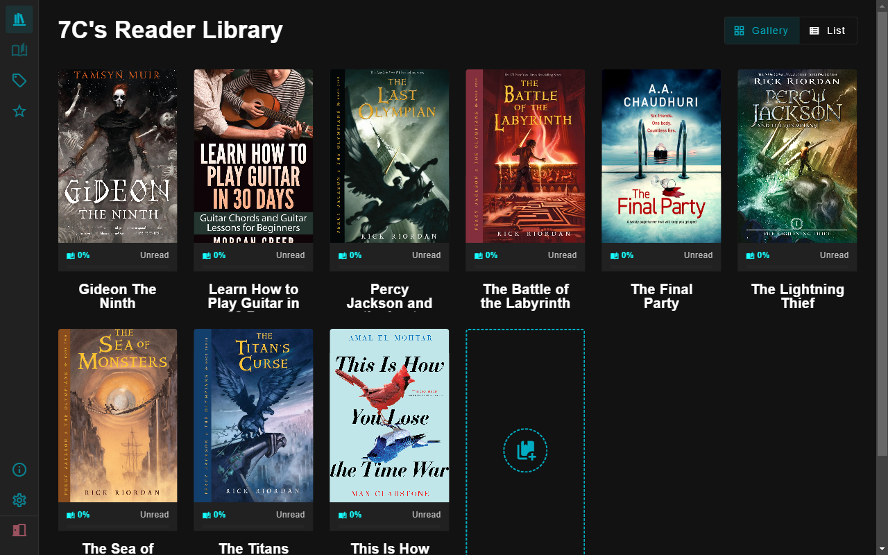
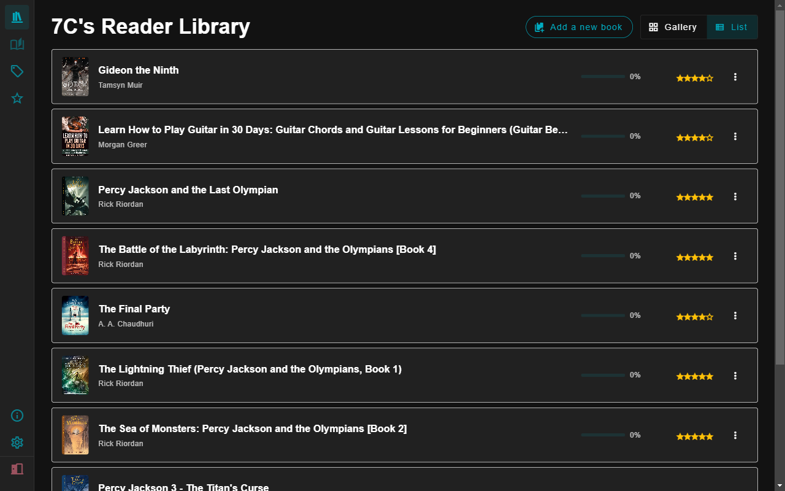
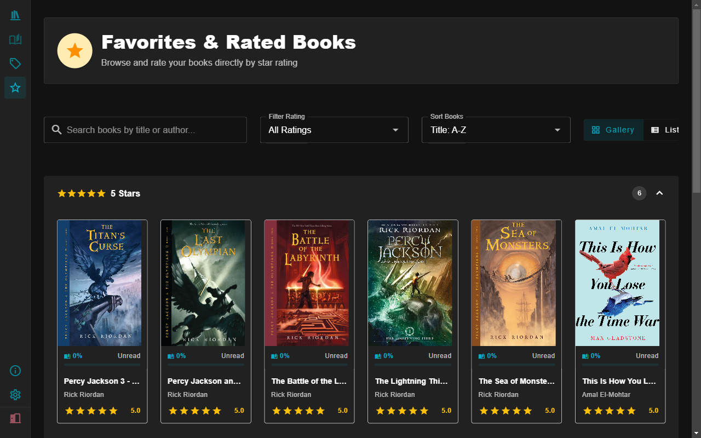
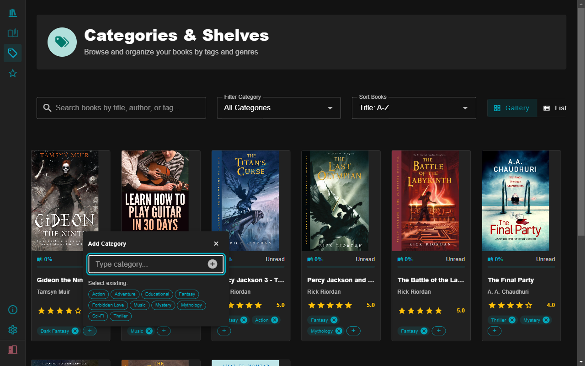
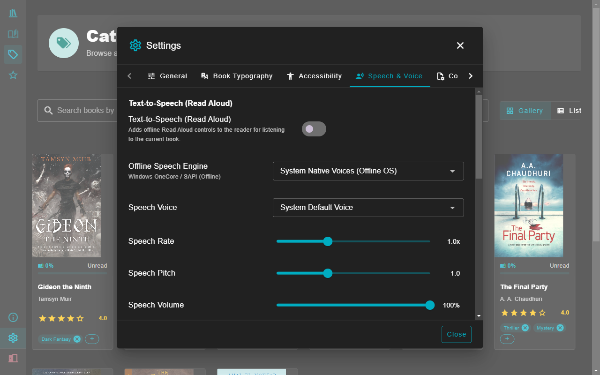
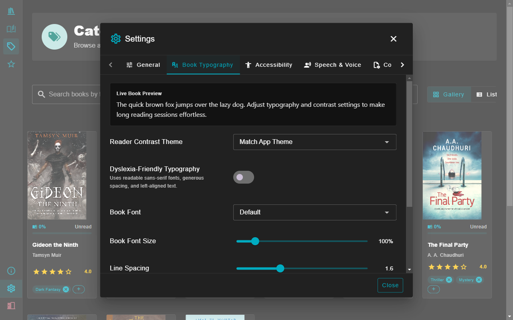
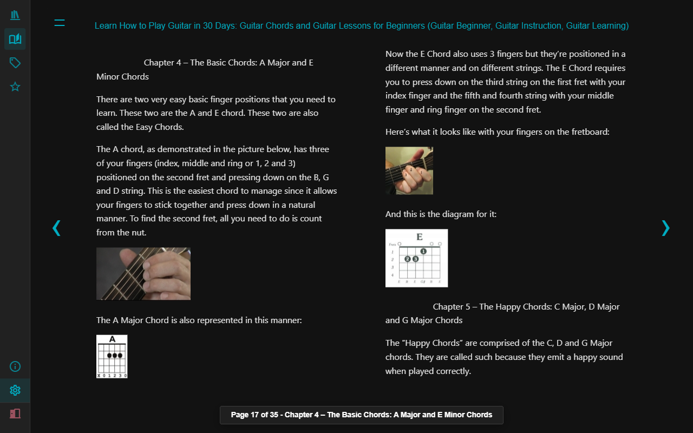
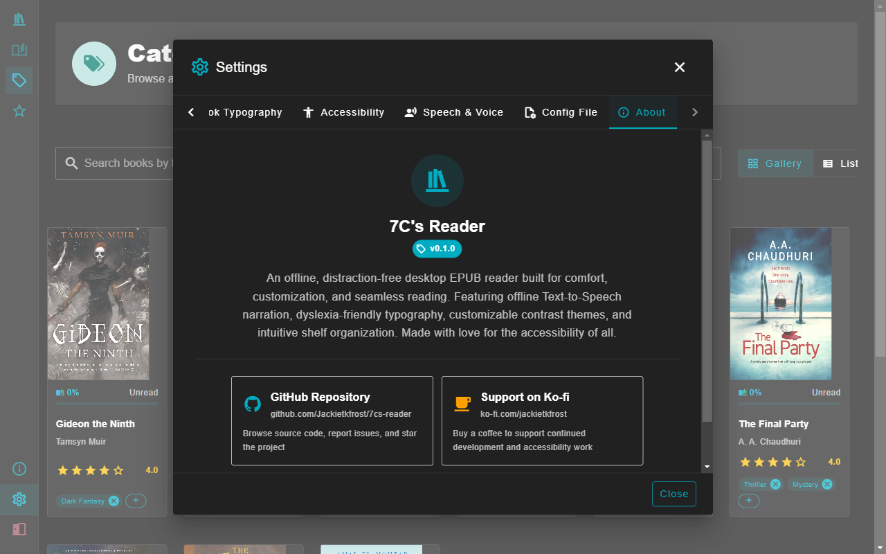

# 7C's Reader

<div align="center">

**접근성과 오프라인 환경에 최적화된 현대적인 데스크톱 EPUB 리더.**

[](LICENSE) [](https://github.com/Jackietkfrost/7cs-reader/releases) [](https://www.electronjs.org/) [](https://vuejs.org/) [](https://www.typescriptlang.org/)

_Made with love for the accessibility of all._

[주요 기능](#-주요-기능) · [스크린샷](#-스크린샷) · [설치-및-다운로드](#-설치-및-다운로드) · [개발-가이드](#-개발-가이드) · [후원-및-지원](#-후원-및-지원) · [라이선스](#-라이선스)

</div>

---

## 📖 개요

**7C's Reader**는 편안함, 접근성, 그리고 완전한 오프라인 개인 정보 보호를 위해 처음부터 설계된 오픈 소스 데스크톱 EPUB 리더입니다. 난독증 친화적인 서체, 고대비 테마, 문장 단위 동기화 강조 표시를 지원하는 음성 낭독(TTS), 그리고 서재 정리 기능까지 지원합니다.

---

## ✨ 주요 기능

### 📚 독서 및 렌더링

-   **완벽한 EPUB 3 지원**: 연속 스크롤 및 페이지 넘김 모드, 빠른 목차 탐색 제공.
-   **도표 및 삽화 정상 표시**: 내부 이미지 및 SVG 그래픽을 blob URL 스트리밍 방식으로 안정적으로 로드.
-   **독서 진도 저장**: 책별 마지막 읽은 위치 자동 저장 및 즉시 복원.

### 🗣️ 오프라인 음성 낭독 (TTS)

-   **클라우드 의존성 제로**: Windows Native SAPI 5 및 RHVoice 오프라인 음성 합성 엔진 지원.
-   **문장별 동기화 강조 및 자동 페이지 넘김**: 재생 중인 문장을 실시간으로 시각화.
-   **자연스러운 낭독 흐름**: 약어 처리(예: `Mr.`, `Dr.`, `etc.`), 문단 간 일시정지, 음성 속도 및 피치 조절.
-   **음성 다운로드 안내**: 시스템 언어를 감지하여 미설치 시 알맞은 음성 다운로드 페이지로 안내.

### 👁️ 접근성 및 타이포그래피

-   **접근성 친화 폰트**: OpenDyslexic, Lexend, Atkinson Hyperlegible 등 난독증 개선 서체 지원.
-   **실시간 미리보기**: 글자 크기, 줄 간격, 자간, 여백을 실시간으로 확인하며 조절.
-   **고대비 테마**: 다크, 라이트, 세피아, 고대비 다크, 고대비 라이트 지원.

### 🗂️ 서재 관리

-   **갤러리 뷰 및 리스트 뷰**: 모든 서재 화면에서 자유로운 보기 모드 전환.
-   **별점 및 즐겨찾기**: 5성부터 미평가까지 아코디언 그룹화 및 부드러운 페이드 전환.
-   **카테고리 및 선반**: 캡슐 태그 칩과 팝오버를 통한 빠른 태그 추가/삭제, 실시간 필터링.

---

## 📸 스크린샷

### 서재 — 갤러리 및 리스트 뷰

| 갤러리 뷰 | 리스트 뷰 |
| :-: | :-: |
|  |  |

### 별점 및 카테고리

| 별점 평가 도서 | 카테고리 및 서가 |
| :-: | :-: |
|  |  |

### 접근성 및 뷰어 설정

| 오프라인 음성 엔진 설정 | 타이포그래피 설정 및 미리보기 |
| :-: | :-: |
|  |  |

### 뷰어 화면 및 정보

| 도서 삽화 렌더링 화면 | 정보 섹션 및 프로젝트 링크 |
| :-: | :-: |
|  |  |

---

## 📥 설치 및 다운로드

Windows(x64)용 빌드는 [**GitHub Releases**](https://github.com/Jackietkfrost/7cs-reader/releases) 페이지에서 다운로드할 수 있습니다:

| 패키지               | 형식   | 설명                                                        |
| :------------------- | :----- | :---------------------------------------------------------- |
| **포터블 실행 파일** | `.exe` | 설치 없이 어디서나 바로 실행할 수 있는 독립 실행 파일.      |
| **Zip 압축 파일**    | `.zip` | 압축 해제 후 `7cs-reader.exe`를 실행할 수 있는 독립 패키지. |

---

## 🛠️ 개발 가이드

```bash
# 저장소 복제
git clone https://github.com/Jackietkfrost/7cs-reader.git
cd 7cs-reader

# 의존성 패키지 설치
npm install

# 개발 서버 실행
npm run dev

# 테스트 실행
npm test

# 프로덕션 빌드 패키징
npm run build:pre
npx electron-builder --win portable zip
```

---

## 💖 후원 및 지원

-   **버그 리포트 & 이슈 제안**: [GitHub Issues](https://github.com/Jackietkfrost/7cs-reader/issues)
-   **후원하기**: [Ko-fi](https://ko-fi.com/jackietkfrost)

> _"Made with love for the accessibility of all."_

---

## 📄 라이선스

이 프로젝트는 **MIT 라이선스**에 따라 배포됩니다. 자세한 내용은 [LICENSE](LICENSE) 파일을 참조하십시오.
