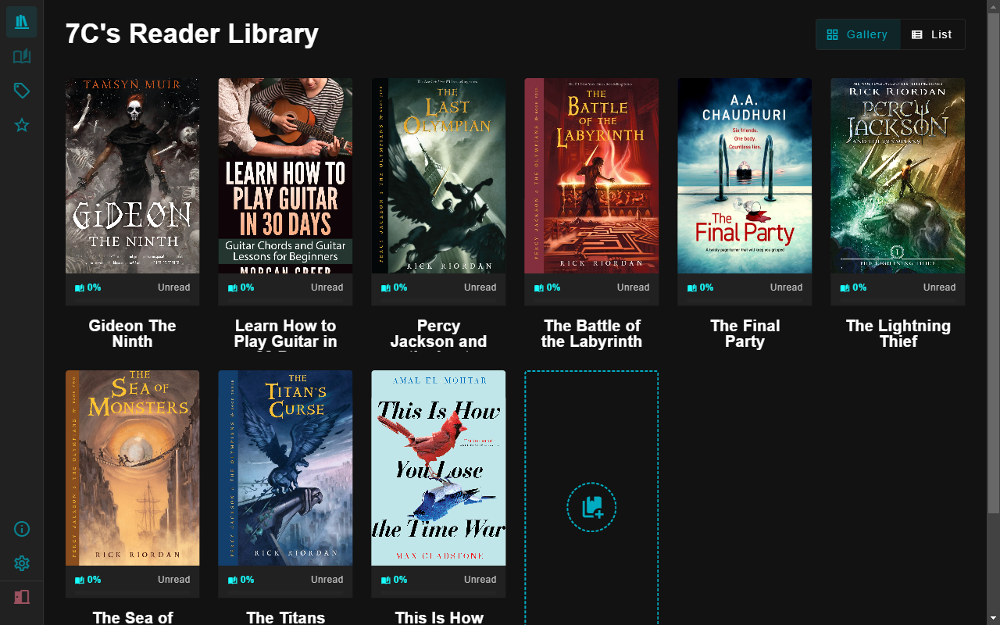
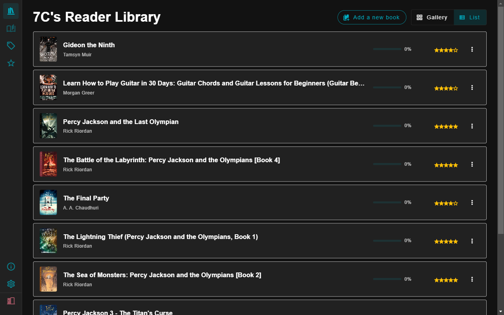
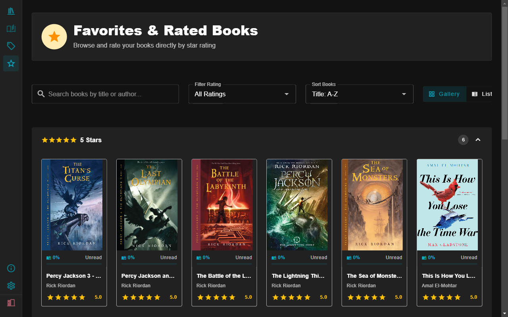
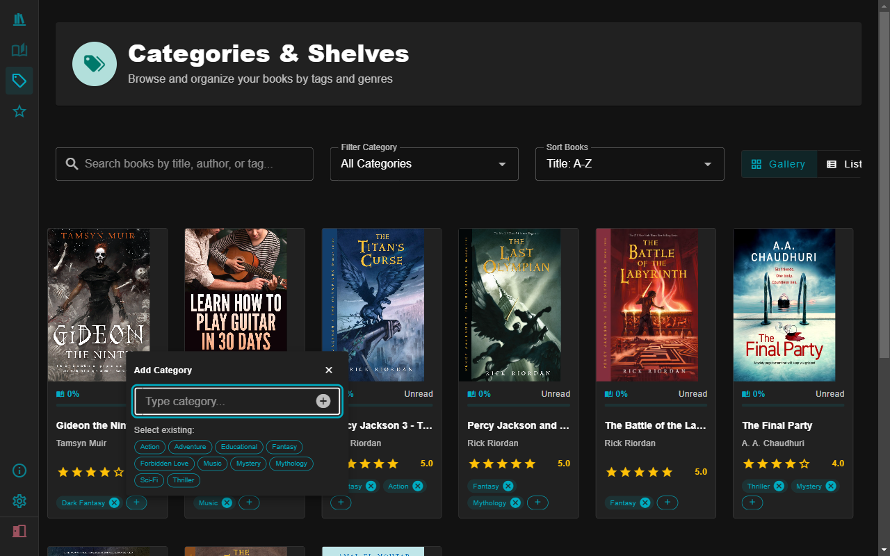
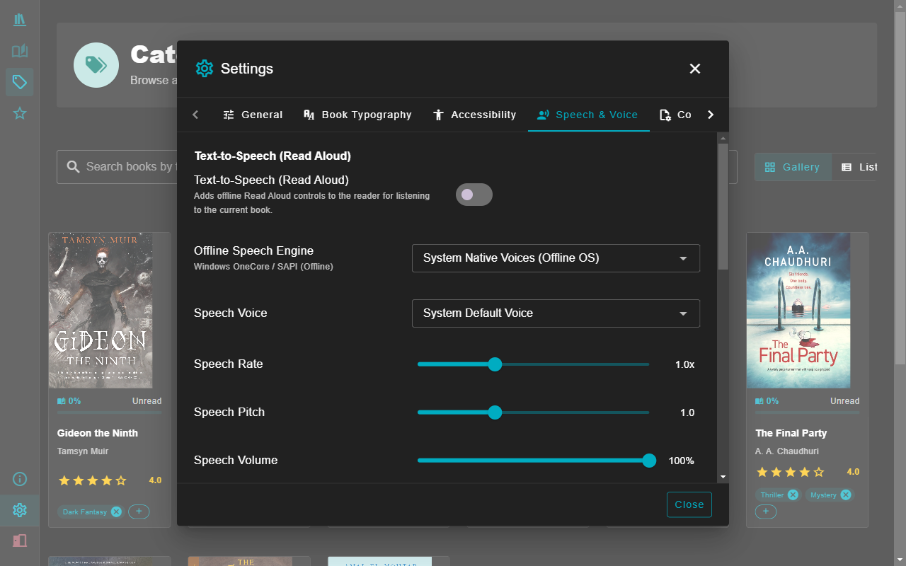
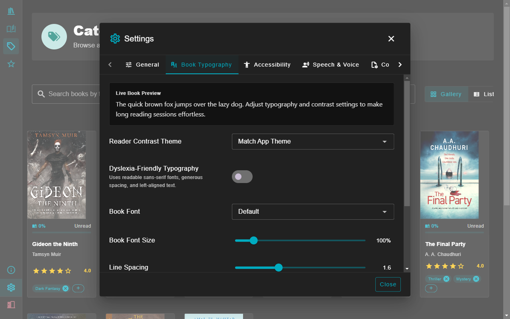
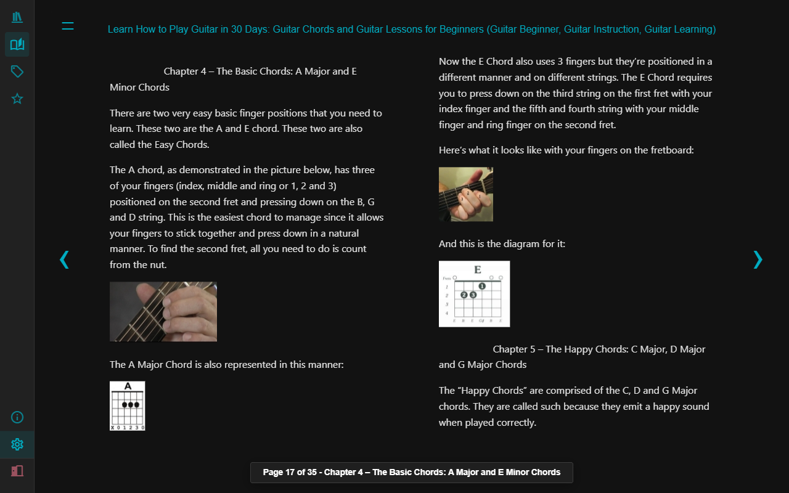
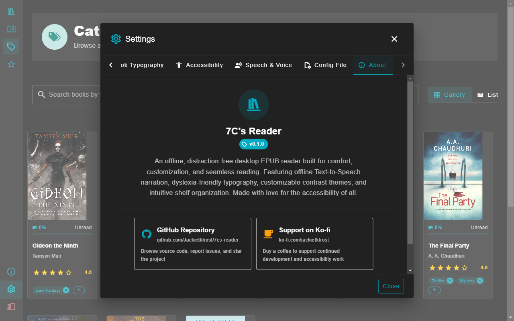

# 7C's Reader

<div align="center">

**A modern, accessible, offline-first EPUB desktop reader.**

[](LICENSE) [](https://github.com/Jackietkfrost/7cs-reader/releases) [](https://www.electronjs.org/) [](https://vuejs.org/) [](https://www.typescriptlang.org/)

_Made with love for the accessibility of all._

[Features](#-features) · [Screenshots](#-screenshots) · [Installation & Downloads](#-installation--downloads) · [Development](#-development) · [Support](#-support) · [License](#-license)

</div>

---

## 📖 Overview

**7C's Reader** is an open-source desktop EPUB reader built from the ground up for comfort, accessibility, and complete offline privacy. Whether you require dyslexia-friendly typefaces, high-contrast themes, hands-free text-to-speech audio narration with synchronized sentence highlighting, or flexible library sorting across thousands of volumes, 7C's Reader gives you full control over your reading experience.

---

## ✨ Features

### 📚 Reading & Rendering

-   **Full EPUB 3 Support**: Continuous scrolling and paginated modes with fast chapter navigation and a hierarchical Table of Contents.
-   **Embedded Diagrams & Illustrations**: Built-in asset resolver and blob streamer ensures internal EPUB illustrations, technical diagrams, and SVG graphics render reliably without broken image links.
-   **Progress Tracking**: Automatic per-book progress saving with instant resume from your exact last-read location.

### 🗣️ Offline Text-to-Speech (Read Aloud)

-   **Zero Cloud Dependence**: Full offline speech synthesis powered by native Windows Speech API (SAPI 5 / OneCore) and [RHVoice](https://rhvoice.org/).
-   **Synchronized Highlighting**: Follow along with sentence-by-sentence visual tracking and automatic page turns during speech playback.
-   **Natural Narration Flow**: Smart abbreviation sanitization (e.g. `Mr.`, `Dr.`, `etc.`, `vs.`) prevents artificial mid-sentence pauses, with customizable paragraph pauses, speech rate, and pitch controls.
-   **One-Click Voice Guidance**: Automatically queries system language and directs users to matching voice downloads if no offline voices are detected.

### 👁️ Accessibility & Typography

-   **Accessible Fonts**: Native support for dyslexia-friendly typefaces (including OpenDyslexic, Lexend, and Atkinson Hyperlegible) alongside all installed system fonts.
-   **Live Preview Controls**: Real-time adjustment of font sizes, line heights, letter spacing, and margins with instant visual feedback.
-   **High-Contrast Color Themes**: Choose between Dark, Light, Sepia, High Contrast Dark, High Contrast Light, or automatically match your operating system theme.

### 🗂️ Library Organization

-   **Dual Display Modes**: Seamlessly toggle between **Gallery View** and **List View** across your library, favorites, and category shelves.
-   **Star Ratings & Favorites**: In-place star ratings with collapsible accordions (5 Stars through Unrated) and deferred fade transitions so books don't abruptly jump while interacting.
-   **Categories & Shelves**: Capsule tag chips with an instant `+` popover to assign or create tags without modal interruption, complete with real-time genre filtering and search.
-   **Metadata Editing**: In-app editor for book titles, authors, genres, descriptions, and custom tags.

### ⚙️ Portability & Privacy

-   **Offline & Private**: Your books and reading data stay entirely local on your device.
-   **JSON Configuration Management**: Single-click export, import, or manual JSON editing for all reader settings.

---

## 📸 Screenshots

### Library — Gallery & List Views

| Gallery View | List View |
| :-: | :-: |
|  |  |

### Organization — Ratings & Categories

| Starred & Rated Books | Categories & Shelves |
| :-: | :-: |
|  |  |

### Accessibility & Reader Customization

| Offline Speech & Voice Engine | Typography & Live Preview |
| :-: | :-: |
|  |  |

### Reader Experience & About View

| Reader Screen with Diagrams & Images | About Section & Project Links |
| :-: | :-: |
|  |  |

---

## 📥 Installation & Downloads

Pre-built binaries for Windows (x64) are available on the [**GitHub Releases**](https://github.com/Jackietkfrost/7cs-reader/releases) page:

| Package | Format | Description |
| :-- | :-- | :-- |
| **Portable Executable** | `.exe` | Standalone portable executable. No installer required — run directly from anywhere. |
| **Zip Archive** | `.zip` | Portable archive. Extract to any directory and launch `7cs-reader.exe`. |

### Setting Up Offline Voices (Optional)

7C's Reader supports native Windows SAPI voices out of the box. For high-quality, free, open-source offline multilingual voices:

1. Open **Settings** (`Ctrl+,`) and navigate to the **Speech & Voice** tab.
2. If RHVoice voices are not detected, click **Download RHVoice Voices** or visit [RHVoice Languages](https://rhvoice.org/languages/).
3. Download the installer for your preferred language and voice (e.g. Alan, Evgeniy, etc.). The installer configures SAPI 5 compatibility automatically — no additional software required.
4. Click **Re-check** in 7C's Reader to immediately begin using your new voice.

---

## 🛠️ Development

### Prerequisites

-   **Node.js** >= 22.0.0
-   **npm** >= 10.0.0

### Setup & Running Locally

```bash
# Clone the repository
git clone https://github.com/Jackietkfrost/7cs-reader.git
cd 7cs-reader

# Install dependencies
npm install

# Start the development server with Vite hot reload
npm run dev
```

### Testing & Verification

```bash
# Run the complete Playwright end-to-end test suite
npm test

# Run type checking
npx vue-tsc --noEmit

# Format code with Prettier
npm run format:fix
```

### Packaging Production Builds

```bash
# Pre-compile renderer and main bundles
npm run build:pre

# Package Windows portable executable and zip archive
npx electron-builder --win portable zip
```

---

## 💖 Support & Community

If you encounter any bugs, have feature suggestions, or need accessibility assistance, please open an issue:

-   **Bug Reports & Issues**: [GitHub Issues](https://github.com/Jackietkfrost/7cs-reader/issues)
-   **Support the Project**: [Ko-fi](https://ko-fi.com/jackietkfrost)

> _"Made with love for the accessibility of all."_

---

## 📄 License

This project is licensed under the **MIT License** — see the [LICENSE](LICENSE) file for details.
