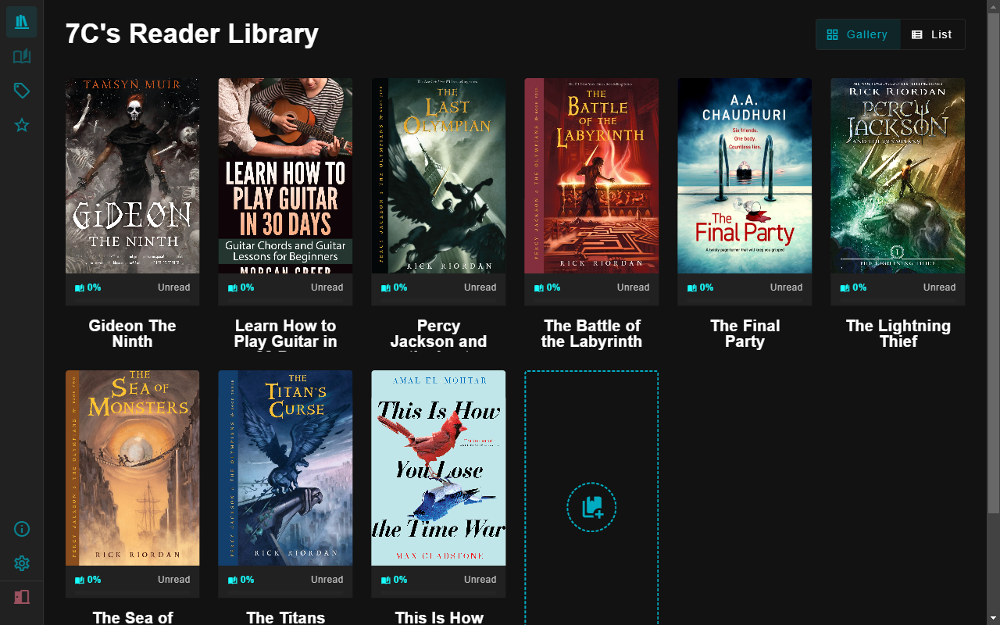
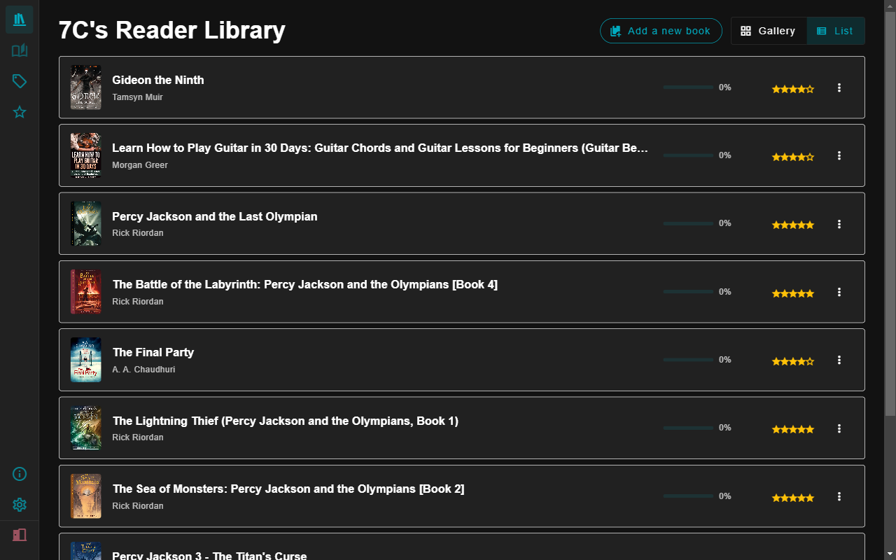
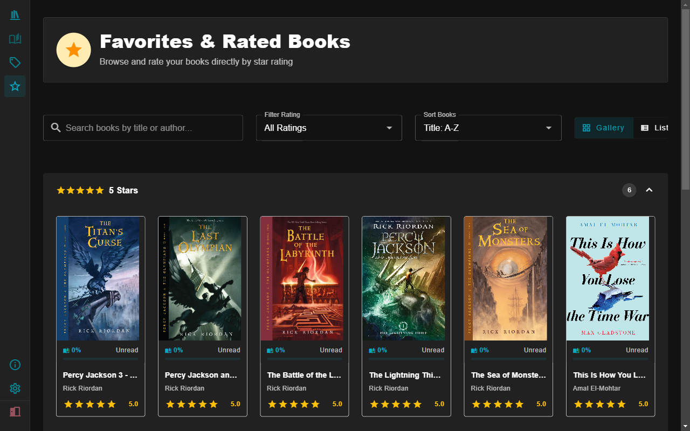
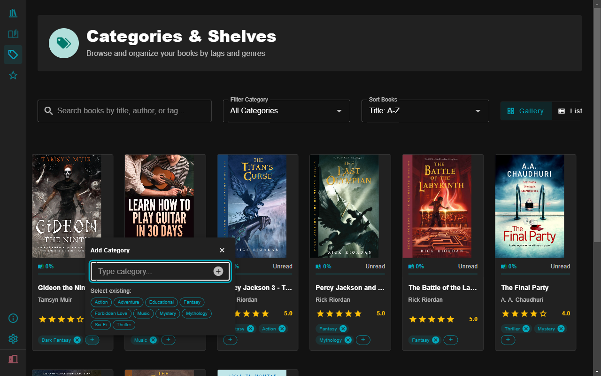
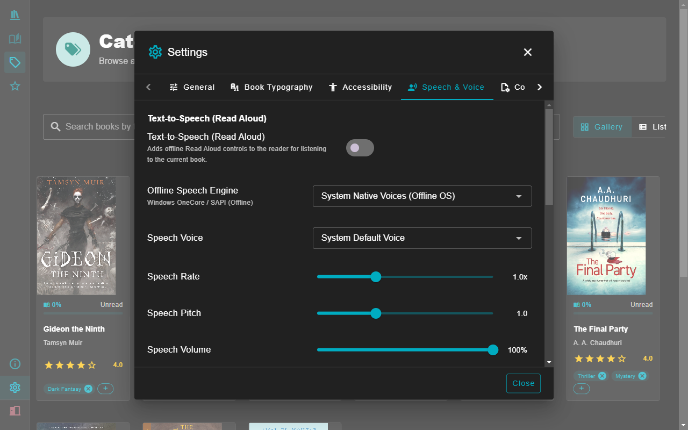
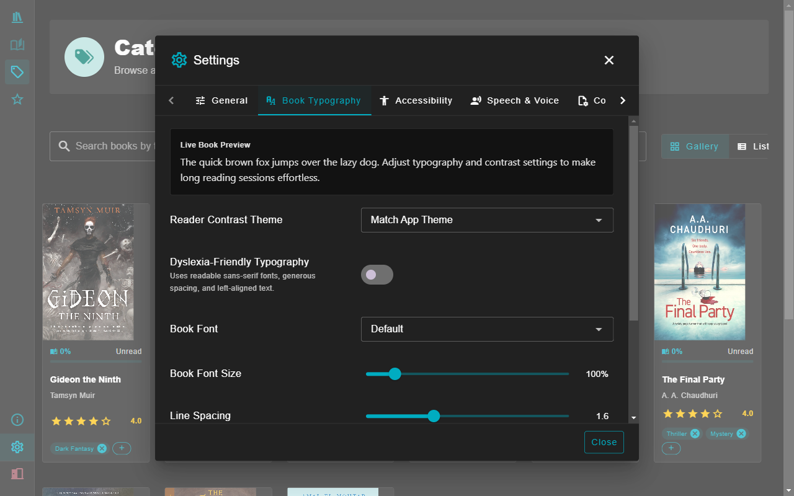
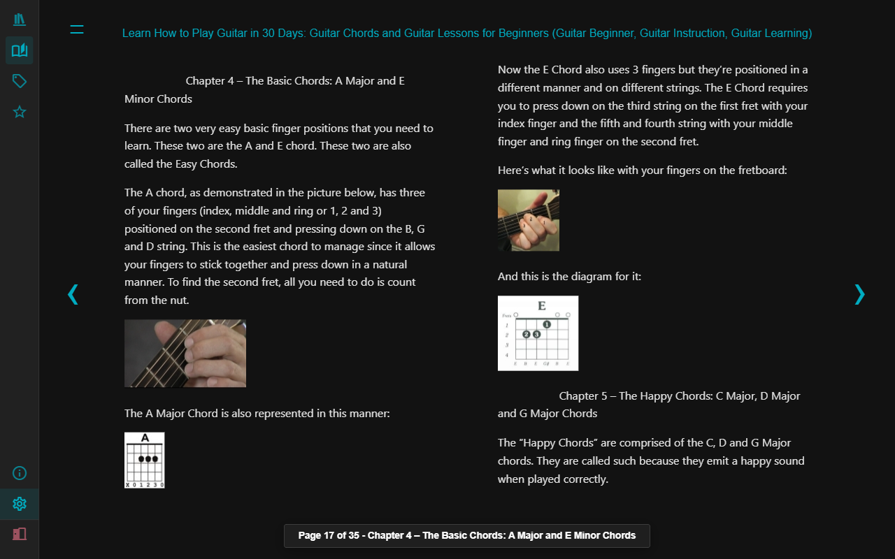
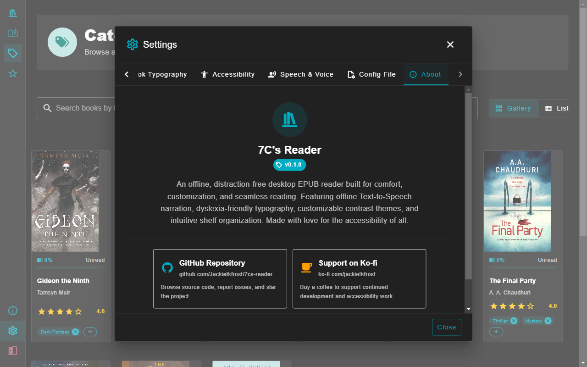

# 7C's Reader

<div align="center">

**现代、无障碍、完全离线的桌面 EPUB 阅读器。**

[](LICENSE) [](https://github.com/Jackietkfrost/7cs-reader/releases) [](https://www.electronjs.org/) [](https://vuejs.org/) [](https://www.typescriptlang.org/)

_Made with love for the accessibility of all._

[功能特性](#-功能特性) · [界面截图](#-界面截图) · [安装与下载](#-安装与下载) · [开发指南](#-开发指南) · [支持与社区](#-支持与社区) · [许可证](#-许可证)

</div>

---

## 📖 概述

**7C's Reader** 是一款专为舒适阅读、无障碍访问和完全本地隐私保护而设计的开源桌面 EPUB 阅读器。无论是对诵读障碍友好的字体、高对比度主题、带句子级高亮同步的离线语音朗读（TTS），还是灵活的藏书分类整理，7C's Reader 都能为您提供舒适定制的阅读体验。

---

## ✨ 功能特性

### 📚 阅读与排版

-   **完整 EPUB 3 支持**：支持平滑翻页与滚动模式、快速章节跳转与目录索引。
-   **内置图表与插图正常渲染**：通过 blob URL 流式加载，稳定呈现 EPUB 内部图片与 SVG 图表，避免图片破损或加载失败。
-   **阅读进度实时保存**：自动记录每本书的阅读位置，随时继续阅读。

### 🗣️ 离线语音朗读 (TTS)

-   **零云端依赖**：内置支持 Windows 本地 SAPI 5 / OneCore 引擎及 [RHVoice](https://rhvoice.org/) 离线语音。
-   **句子同步高亮与自动翻页**：朗读过程中实时高亮当前句，并自动随音频翻页。
-   **自然流畅朗读**：智能过滤缩写引起的停顿（如 `Mr.`, `Dr.`, `etc.`），支持段落停顿调节、语速与音调调节。
-   **一键语音下载引导**：自动检测系统语言，未检测到离线语音时直达对应语言安装包。

### 👁️ 无障碍与排版定制

-   **无障碍字体**：支持 OpenDyslexic、Lexend、Atkinson Hyperlegible 等无障碍字体及所有系统字体。
-   **实时预览调节**：实时调整字号、行距、字间距与页边距。
-   **高对比度配色**：提供深色、浅色、羊皮纸色、高对比度深色、高对比度浅色及跟随系统主题。

### 🗂️ 书库整理

-   **双视图模式**：在书库、收藏夹与分类书架中随时切换**画廊网格视图**与**列表视图**。
-   **星级评分与收藏**：折叠手风琴分组（5 星至未评级），带平滑延迟淡入淡出动画，避免误操作时内容跳动。
-   **分类与标签胶囊**：采用药丸胶囊标签与即时 `+` 弹出卡片，免弹窗快速添加或删除分类，支持即时搜索与过滤。

---

## 📸 界面截图

### 书库 — 画廊与列表视图

| 画廊视图 | 列表视图 |
| :-: | :-: |
|  |  |

### 评级与分类书架

| 收藏与星级评分 | 分类书架与标签 |
| :-: | :-: |
|  |  |

### 无障碍与语音设置

| 离线语音引擎设置 | 排版自定义与实时预览 |
| :-: | :-: |
|  |  |

### 阅读界面与关于页面

| 书籍插图图表显示 | 关于页面与项目链接 |
| :-: | :-: |
|  |  |

---

## 📥 安装与下载

可在 [**GitHub Releases**](https://github.com/Jackietkfrost/7cs-reader/releases) 页面下载 Windows (x64) 预编译包：

| 安装包                | 格式   | 说明                                          |
| :-------------------- | :----- | :-------------------------------------------- |
| **便携版 (Portable)** | `.exe` | 独立便携可执行文件，无需安装，解压即可运行。  |
| **Zip 压缩包**        | `.zip` | 便携压缩包，解压后直接启动 `7cs-reader.exe`。 |

---

## 🛠️ 开发指南

```bash
# 克隆仓库
git clone https://github.com/Jackietkfrost/7cs-reader.git
cd 7cs-reader

# 安装依赖
npm install

# 启动开发服务器
npm run dev

# 运行自动化测试
npm test

# 打包生产版本
npm run build:pre
npx electron-builder --win portable zip
```

---

## 💖 支持与社区

-   **问题反馈与建议**：[GitHub Issues](https://github.com/Jackietkfrost/7cs-reader/issues)
-   **赞助支持**：[Ko-fi](https://ko-fi.com/jackietkfrost)

> _"Made with love for the accessibility of all."_

---

## 📄 许可证

本项目基于 **MIT 许可证** 开源 — 详情请参见 [LICENSE](LICENSE) 文件。
